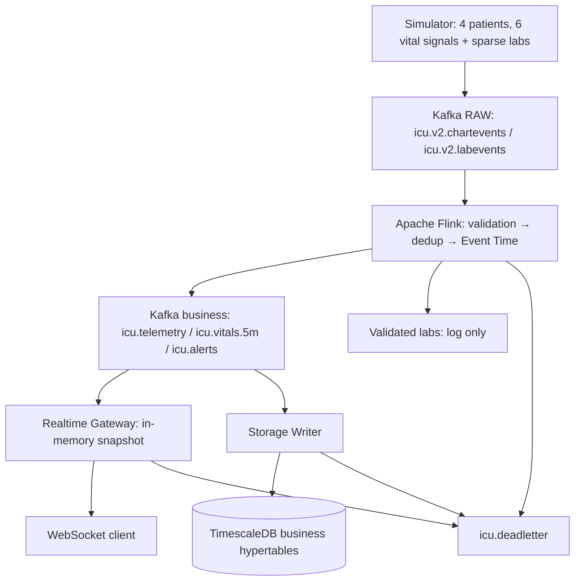

# Luồng dữ liệu Kafka, Flink, Gateway và TimescaleDB

## Kiến trúc hiện tại

Gateway và Writer dùng Consumer Group riêng, cùng nhận ba business topic.
Gateway giữ trạng thái trong RAM, không truy vấn DB. Đường live Kafka →
Gateway → WebSocket không chờ transaction DB. Khi Writer lỗi, kiểm tra lag/
DLQ riêng; snapshot live không bảo đảm dữ liệu đã ghi bền vững. Chưa có
frontend ICU hoàn chỉnh hoặc API truy vấn lịch sử từ DB.

## Định danh và simulator

Bốn bộ định danh đóng băng trong [demo_patients.yaml](config/demo_patients.yaml)
lấy từ MIMIC-IV Clinical Demo 2.2. Giường và số đo là mô phỏng của dự án.
P01–P04 (`demo_id`) chỉ nằm trong registry ứng dụng, không phải cột của bảng
`patients`. `bed_id` là JSON integer/API và `INTEGER NOT NULL UNIQUE` trong DB.

| Patient / `bed_id` | `subject_id` | `hadm_id` | `stay_id` |
|---|---|---|---|
| P01 / 1 | 10039708 | 24928679 | 37323533 |
| P02 / 2 | 10019003 | 21457723 | 35727289 |
| P03 / 3 | 10014354 | 29600294 | 39864867 |
| P04 / 4 | 10007818 | 22987108 | 32359580 |

Normal phát cả HR/MAP/SBP/DBP/SpO2/RR mỗi giây cho mỗi patient: 24 RAW message/
giây, cùng timestamp cho sáu signal trong một tick. HF100/HF200 tăng lên
100/200 tick mỗi giây, tương ứng 2.400/4.800 RAW numeric message/giây.
Lab Lactate giữ cadence T+0 rồi mỗi 240 giây. FastVerify dùng 6 phút logic
ở tốc độ 24×; các ngưỡng xử lý vẫn tính theo Event Time.

P01 ổn định; P02 MAP thấp từ T+12; P03 có các đoạn thấp ngắn bị ngắt bởi
normal đủ để recovery; P04 chèn quality probe thưa: HR Out-of-order ở T+45,
duplicate T+120, SpO2 invalid T+210 và HR Late Event T+300. HR Out-of-order
có timestamp T+44, không làm phát thêm wide sample đã hoàn tất nếu giá trị
giống nhau. Probe duplicate/invalid/late đi vào DLQ.

## Sáu topic ứng dụng

Mỗi topic có **1 partition, replication factor 1** trên broker local hiện
có. RAW dùng Schema Version `3.0` với `bed_id` integer; business và DLQ giữ
`1.0`. RAW `2.0` dùng bed string là phiên bản cũ không được validator mới nhận;
launcher reset topic và Flink state trước khi phát RAW mới.

| Topic | Kafka key UTF-8 | Nơi tạo → nơi đọc |
|---|---|---|
| `icu.v2.chartevents` | `stay_id` dạng chuỗi | Simulator → Flink |
| `icu.v2.labevents` | `mapped_stay_id` dạng chuỗi | Simulator → Flink |
| `icu.telemetry` | `stay_id` dạng chuỗi | Flink LONG → WIDE → Gateway và Writer |
| `icu.vitals.5m` | `stay_id` dạng chuỗi | Flink trung bình 5m/slide 1m → Gateway và Writer |
| `icu.alerts` | `stay_id` dạng chuỗi | Flink tạo alert; status event từ producer theo contract → Gateway và Writer |
| `icu.deadletter` | Key gốc, fallback `dlq_id` | Flink/Gateway/Writer → điều tra qua Kafka UI; không ghi business DB |

Chi tiết field/header/JSON ở [KAFKA_MESSAGE_FORMATS.md](docs/KAFKA_MESSAGE_FORMATS.md).
Consumer hiện tại chỉ dùng các topic trong bảng. Bootstrap không áp dụng
cấu hình production nhiều partition/replica; retention và cleanup policy kế
thừa broker nếu không được đặt riêng.

## Flink xử lý gì?

Nguồn thực thi là [runtime_pipeline.py](jobs/flink/runtime_pipeline.py).

1. Parse UTF-8/JSON nghiêm ngặt; kiểm tra đúng RAW schema, bốn bộ định danh,
   từ điển item/unit, timestamp và khoảng giá trị kỹ thuật. MAP 62 vẫn hợp lệ;
   SpO2 −5 không hợp lệ. JSON duplicate field, NaN/Infinity hoặc số tràn cũng
   bị từ chối.
2. Dedup bằng stream + `event_id` trong managed state, TTL 24 giờ theo
   processing time. Bản trùng không tham gia tính toán lần thứ hai.
3. Gán Event Time và Watermark với bounded Out-of-order tolerance **2 giây**;
   input idleness là 5 giây. Event tại hoặc trước Watermark hiệu lực lúc đến
   là quá muộn. Event đến khác thứ tự nhưng còn sau Watermark được chấp nhận.
4. Từ chartevents hợp lệ, tạo ba nhánh: wide telemetry, thống kê từ wide
   telemetry và rule MAP từ các MAP RAW hợp lệ. DBP/RR vẫn nằm trong RAW.
5. Labevents cũng parse/validate/dedup/phân loại Event Time; lab hợp lệ được
   `print` vào log Flink. **Chưa có business lab topic, DB persistence hay
   tương quan MAP–Lactate BR-6**. Cần thống nhất lab contract trước khi mở rộng.

Job chạy parallelism 1, một slot. Checkpoint bình thường 10 giây, FastVerify
2 giây. Kafka sink có ngữ nghĩa **AT_LEAST_ONCE**; ID ổn định và khóa tự nhiên
hỗ trợ xử lý lại an toàn khi message được giao lặp.

## Từ LONG sang WIDE và cửa sổ 5 phút

RAW chứa một signal/message. Flink nhóm theo `stay_id + sample_time` chính
xác đến microsecond, chuẩn hóa UTC, ghép HR/MAP/SBP/SpO2 thành
`heart_rate/map/sbp/spo2`. Đủ bốn component thì phát ngay một `icu.telemetry`.
Nếu thiếu component, Watermark chốt sample với field thiếu là `null`; sample
chỉ có DBP/RR không tạo wide output rỗng. Không có correction/upsert cho wide
đã phát; component xung đột sau khi phát bị từ chối, quá Watermark thì bị
chặn từ bước Late Event. Khi input dừng, Watermark có thể chưa chốt phần đuôi.

Flink tính trung bình từng field khác null trên cửa sổ Event Time
`[window_end − 5 phút, window_end)`, trượt mỗi **1 phút**, theo `stay_id`.
Output `icu.vitals.5m` có bốn `avg_*`; field không có quan sát là null.
Cửa sổ không có dữ liệu không phát. Watermark đóng cửa sổ, không có luồng
sửa lại cửa sổ đã đóng. Các cửa sổ đầu có thể chứa ít hơn 5 phút dữ liệu đã
quan sát. TimescaleDB chỉ lưu kết quả, không tính lại trung bình.

## Cảnh báo MAP và ba khoảng thời gian khác nhau

| Khoảng thời gian | Vai trò |
|---|---|
| 5 phút, slide 1 phút | Thống kê telemetry |
| 30 giây | Low evidence để phát `HYPOTENSION_SUSTAINED` |
| 10 giây | Cửa sổ rolling chứa ít nhất 5 observation normal để xác nhận recovery |

MAP được gom thành bucket UTC 1 giây, lấy median và chỉ quyết định sau khi
Watermark chốt bucket. MAP `<65` là low; `>=65` là positive recovery. Tối đa
một positive observation/bucket, nên HF không recovery chỉ bằng 5 RAW sample.
Gap MAP tối đa **3 giây**; lớn hơn thì bỏ continuity của episode.

Low evidence cộng các khoảng mà bucket đứng trước là low; khoảng normal
không được cộng. Ví dụ 15 giây low + 3 giây normal + 15 giây low có thể alert
ở T+33. Năm bucket positive trong `(t−10s, t]` xóa evidence và re-arm; chưa
đủ năm thì episode vẫn tiếp tục. Mỗi episode phát một alert `CRITICAL/ACTIVE`.

P02 đủ evidence tại T+42, sau đó chờ bucket finality. Bucket 1 giây cộng
tolerance 2 giây thường cần khoảng 3 giây Event Time từ đầu bucket khi stream
tiếp tục tiến; đây chưa bao gồm tải xử lý. FastVerify đo riêng độ trễ
**sau khi Flink phát** đến Gateway/WebSocket, không bao gồm thời gian xác nhận
và finality. Late recovery không thu hồi alert đã gửi.
Xem [rule và các timeline](docs/ALERT_RULES_AND_FALSE_ALARM_MANAGEMENT.md).

## Gateway và Storage Writer

| Consumer Group | Subscriptions | Vai trò |
|---|---|---|
| `icu-ui-gateway-v2` | `icu.telemetry`, `icu.vitals.5m`, `icu.alerts` | RAM snapshot và WebSocket |
| `icu-timescale-writer-v2` | Cùng ba topic | Ghi ba business hypertable |
| `icu-flink-v2` | Hai RAW topic | Flink input |

Gateway cung cấp `/api/health`, `/api/patients`, `/api/patients/{demo_id}`,
`/api/snapshot` và `/ws` trên cổng 8083. WebSocket gửi `SNAPSHOT`, tiếp theo
là `TELEMETRY_SAMPLE`, `VITALS_WINDOW_5M`, `ALERT` hoặc `ALERT_STATUS_CHANGED`.
Snapshot giữ bốn vital mới nhất, summary và tối đa 100 alert/patient. Event
telemetry cũ không ghi đè giá trị mới. Gateway đọc lại business topic từ đầu
khi nhận assignment để dựng RAM state; client chậm kết nối lại lấy snapshot.
Gateway không commit offset trong implementation hiện tại; không dùng lag
dựa trên committed offset của group này để kết luận UI đã bắt kịp. Đối chiếu
timestamp trong snapshot/WebSocket và `/api/health` khi kiểm tra đường live.

Writer ánh xạ `icu.telemetry` → `patient_telemetry_stream`, `icu.vitals.5m` →
`vitals_sliding_window_5m`, `icu.alerts` → `sepsis_alert_events`. Ghi idempotent
bằng khóa tự nhiên; **DB commit trước Kafka offset commit**. Status event chỉ
cập nhật alert có sẵn, không insert. Sau tối đa 8 lần thử lỗi DB tạm thời,
Writer chuyển message sang DLQ; chỉ commit offset sau khi DLQ được xác nhận.
Không có auto replay DLQ. Chi tiết khóa/transaction ở
[DATABASE_DESIGN.md](docs/DATABASE_DESIGN.md).

DLQ là lỗi kỹ thuật/chất lượng dữ liệu, không phải nơi chứa mọi số đo bất
thường lâm sàng. Một message lỗi business có thể bị cả Gateway lẫn Writer
từ chối, tạo hai DLQ record với `consumer_group` khác nhau.

## Theo dõi một event

Chạy và mở UI theo [README](README.md). Trong Kafka UI, chọn một message
`icu.telemetry`, lấy `stay_id` và `sample_time`; dùng hai giá trị đó đối chiếu
khóa DB. Với alert, đối chiếu `alert_time + alert_id`, kèm `stay_id` khi cập
nhật status. Kiểm tra Writer có ba topic assignment và lag về 0 sau khi drain.
Các câu SQL nằm trong [hướng dẫn DB](docs/DATABASE_DESIGN.md).

Demo reset sáu topic, ba group và bốn business hypertable theo mặc định.
`chartevents`/`labevents` là source placeholder PostgreSQL thường, luôn trống
trong runtime này; `waveform_segments` là metadata placeholder chưa có writer.
`-KeepDatabaseData` chỉ giữ business DB, Kafka/Gateway vẫn bắt đầu lại.
