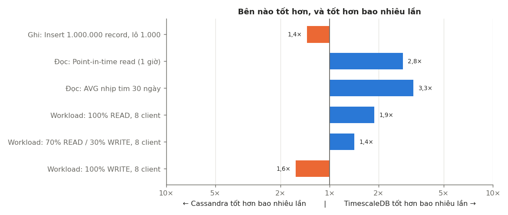
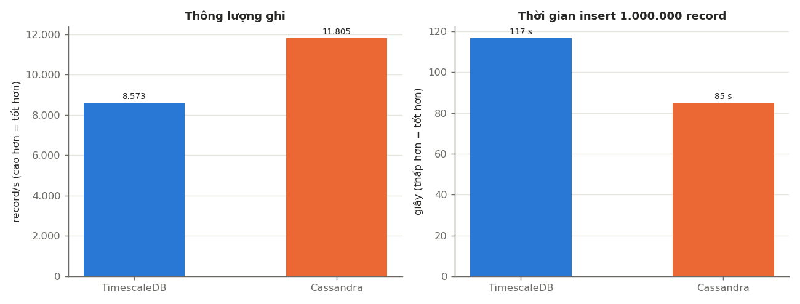
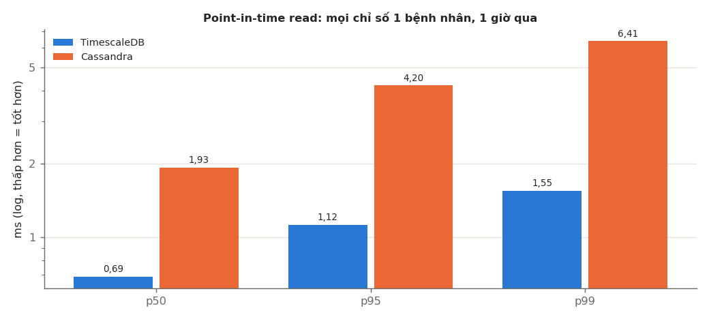
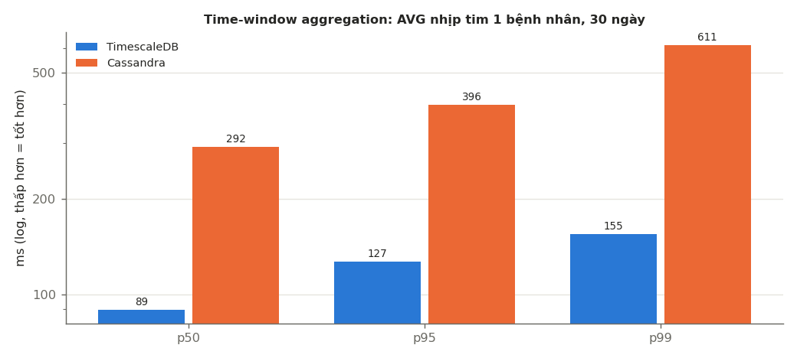
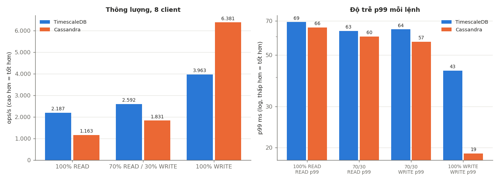
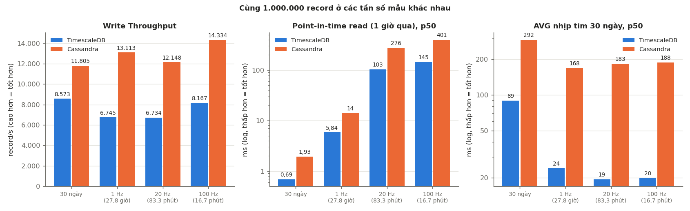

# TimescaleDB vs Cassandra: kết quả benchmark

## Dữ liệu và phương pháp

| # | Phép đo | Cách làm |
|---|---|---|
| 0 | **Data Generator** | Sinh ngẫu nhiên **1.000.000 record** telemetry (HR, MAP, SBP, SpO2) cho **10 bệnh nhân**, 100.000 mẫu/bệnh nhân, có độ lệch thời gian ngẫu nhiên. Mỗi bệnh nhân có mức nền ngẫu nhiên, mỗi mẫu dao động ngẫu nhiên quanh mức đó, trong giới hạn CHECK của schema repo. Seed cố định → chạy lại ra đúng cùng dữ liệu |
| 1 | **Write Throughput** | Insert đủ 1.000.000 record vào DB trống, **batch-size tĩnh 1.000 record**, 4 tiến trình ghi; đo **records/giây** |
| 2 | **Point-in-time Read** | Lấy **toàn bộ chỉ số của 1 bệnh nhân trong 1 giờ qua**. Lặp nhiều lần, bệnh nhân ngẫu nhiên, đo p50/p95/p99 |
| 3 | **Time-Window Aggregation** | **AVG nhịp tim của 1 bệnh nhân trong 30 ngày** (100.000 mẫu, đặc trưng của dashboard ICU) |
| 4 | **Workloads** | 8 client song song, vòng kín, mỗi kịch bản 20 s: **100% READ**, **70% READ / 30% WRITE**, **100% WRITE**. READ = point-in-time read; WRITE = insert 1 record. Ghi nhận **throughput (ops/s)** và **latency (ms)** |

Chạy **4 kịch bản thời gian**, cùng 1.000.000 record nhưng trải trong khoảng thời gian khác nhau:

| Kịch bản | Tần số / bệnh nhân | Tổng record/giây | 1.000.000 record trải trong | Chunk 1 giờ của TimescaleDB | Point read trả về |
|---|---:|---:|---|---:|---:|
| **30 ngày** | ~0,04 Hz (1 mẫu/26 s) | ~0,4 | 30 ngày | 720 | 139 hàng |
| **1 Hz** | 1 Hz | 10 | 27,8 giờ | 28 | 3.600 hàng |
| **20 Hz** | 20 Hz | 200 | 83,3 phút | 2 | 72.000 hàng |
| **100 Hz** | 100 Hz | **1.000** | **16,7 phút** | 1 | 100.000 hàng |

## Tóm tắt

| Nhóm | Phép đo | TimescaleDB | Cassandra | Đơn vị | Bên tốt hơn |
|---|---|---:|---:|---|---|
| Ghi | Insert 1.000.000 record, lô 1.000 | 8.573 | 11.805 | record/s | **Cassandra 1,4×** |
| Đọc | Point-in-time read (1 giờ) | 0,69 | 1,93 | ms p50 | **TimescaleDB 2,8×** |
| Đọc | AVG nhịp tim 30 ngày | 89,39 | 291,65 | ms p50 | **TimescaleDB 3,3×** |
| Workload | 100% READ, 8 client | 2.187 | 1.163 | ops/s | **TimescaleDB 1,9×** |
| Workload | 70% READ / 30% WRITE, 8 client | 2.592 | 1.831 | ops/s | **TimescaleDB 1,4×** |
| Workload | 100% WRITE, 8 client | 3.963 | 6.381 | ops/s | **Cassandra 1,6×** |

TimescaleDB tốt hơn ở **4** phép đo, Cassandra ở **2** (trên 6). Với độ trễ, nhỏ hơn là tốt hơn.

## 1. Write Throughput: insert 1.000.000 record (kịch bản 30 ngày)

| DB | record | thời gian (s) | **record/s** | p50 / lô (ms) | p95 / lô (ms) | p99 / lô (ms) | CPU DB % |
|---|---:|---:|---:|---:|---:|---:|---:|
| TimescaleDB | 1.000.000 | 116,7 | **8.573** | 364,6 | 739,2 | 910,4 | 182,9 |
| Cassandra | 1.000.000 | 84,7 | **11.805** | 298,3 | 596,9 | 800,4 | 206,2 |

Bên ghi nhanh hơn: **Cassandra 1,4×**.

## 2. Point-in-time read: mọi chỉ số 1 bệnh nhân, 1 giờ qua (kịch bản 30 ngày)

Lặp 300 lần; trung bình **139 hàng** trả về.

| DB | p50 ms | p95 ms | p99 ms | max ms | Kết quả giống TimescaleDB |
|---|---:|---:|---:|---:|---|
| TimescaleDB | **0,69** | 1,12 | 1,55 | 4,70 | ✅ |
| Cassandra | **1,93** | 4,20 | 6,41 | 17,44 | ✅ |

So p50: **TimescaleDB 2,8×**.

## 3. Time-window aggregation: AVG nhịp tim 1 bệnh nhân, 30 ngày (kịch bản 30 ngày)

Lặp 50 lần; trung bình **1 hàng** trả về (1 giá trị, tính trên 100.000 mẫu).

| DB | p50 ms | p95 ms | p99 ms | max ms | Kết quả giống TimescaleDB |
|---|---:|---:|---:|---:|---|
| TimescaleDB | **89,39** | 126,82 | 154,88 | 154,88 | ✅ |
| Cassandra | **291,65** | 396,11 | 611,17 | 611,17 | ✅ |

So p50: **TimescaleDB 3,3×**.

## 4. Workloads: 100% READ, 70% READ / 30% WRITE, 100% WRITE (kịch bản 30 ngày)

Trên cùng 1.000.000 record; 8 client song song, vòng kín (gửi lệnh, chờ xong, gửi lệnh tiếp), mỗi kịch bản 20 s sau 5 s khởi động. READ = point-in-time read (1 bệnh nhân ngẫu nhiên, 1 giờ qua); WRITE = insert 1 record mới.

| Kịch bản | DB | **ops/s** | READ ops/s | WRITE ops/s | READ p50 / p99 ms | WRITE p50 / p99 ms |
|---|---|---:|---:|---:|---:|---:|
| 100% READ | TimescaleDB | **2.187** | 2.187 | 0,0 | 1,16 / 69,21 | – / – |
| 100% READ | Cassandra | **1.163** | 1.163 | 0,0 | 2,76 / 65,56 | – / – |
| 70% READ / 30% WRITE | TimescaleDB | **2.592** | 1.816 | 776,2 | 1,05 / 63,36 | 1,25 / 64,37 |
| 70% READ / 30% WRITE | Cassandra | **1.831** | 1.283 | 547,8 | 2,46 / 59,94 | 1,02 / 56,93 |
| 100% WRITE | TimescaleDB | **3.963** | 0,0 | 3.963 | – / – | 1,10 / 42,82 |
| 100% WRITE | Cassandra | **6.381** | 0,0 | 6.381 | – / – | 0,74 / 18,86 |

## 5. Theo tần số mẫu: cùng 1.000.000 record, ép vào khoảng thời gian ngắn dần

Mỗi kịch bản ghi lại 1.000.000 record vào DB trống rồi đo 2 truy vấn. Tần số càng cao, "1 giờ qua" của 1 bệnh nhân càng nhiều hàng (ở 100 Hz là toàn bộ 100.000 mẫu của người đó). TimescaleDB chia chunk 1 giờ nên số chunk giảm từ 720 (30 ngày) xuống 1 (100 Hz); Cassandra chia partition theo ngày.

| Kịch bản | Trải trong | TimescaleDB record/s | Cassandra record/s | Ghi nhanh hơn | Point read: hàng | TS p50 ms | Cass p50 ms | Đọc nhanh hơn | AVG 30 ngày: TS p50 ms | Cass p50 ms | Tổng hợp nhanh hơn |
|---|---|---:|---:|---|---:|---:|---:|---|---:|---:|---|
| **30 ngày** | 30 ngày | 8.573 | 11.805 | **Cassandra 1,4×** | 139 | 0,69 | 1,93 | **TimescaleDB 2,8×** | 89,4 | 291,6 | **TimescaleDB 3,3×** |
| **1 Hz** | 27,8 giờ | 6.745 | 13.113 | **Cassandra 1,9×** | 3.600 | 5,84 | 14,19 | **TimescaleDB 2,4×** | 24,2 | 168,0 | **TimescaleDB 7,0×** |
| **20 Hz** | 83,3 phút | 6.734 | 12.148 | **Cassandra 1,8×** | 72.000 | 103,04 | 275,79 | **TimescaleDB 2,7×** | 19,5 | 183,3 | **TimescaleDB 9,4×** |
| **100 Hz** | 16,7 phút | 8.167 | 14.334 | **Cassandra 1,8×** | 100.000 | 144,72 | 400,71 | **TimescaleDB 2,8×** | 20,0 | 187,8 | **TimescaleDB 9,4×** |

## Kết luận
**TimescaleDB** Kể cả ở 100 Hz (1.000 record/s), TimescaleDB vẫn ghi được 6.700–8.600 record/s, đủ dư
cho repo (hiện ~4 mẫu/s, HF200 ~800/s). Lợi thế ghi 1,4–1,9× của Cassandra vì vậy không dùng tới. Ngược lại, đọc và tổng
hợp theo thời gian, đúng việc `icu-server` và dashboard ICU làm hằng ngày, thì TimescaleDB nhanh hơn 2,4–9,4× ở mọi tần số.

**Cassandra** khi lượng ghi vượt sức một máy (hàng chục nghìn giường, dạng sóng ECG 250–500 Hz),
cần nhiều node / nhiều data center, và truy vấn chủ yếu là "1 bệnh nhân trong 1 khoảng thời gian".