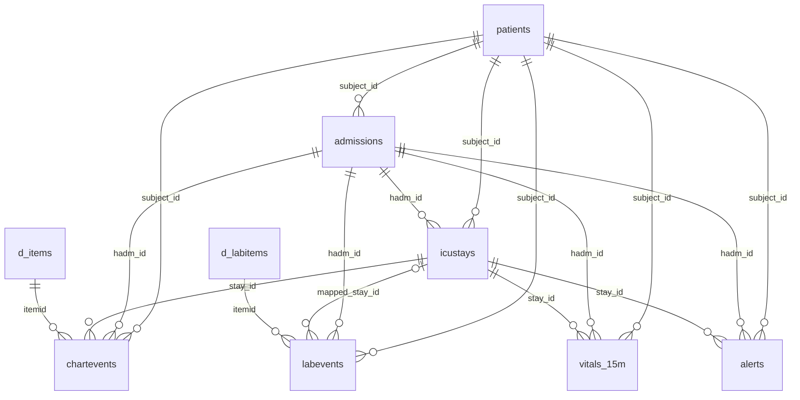

# Thiết kế vật lý TimescaleDB và hợp đồng Storage Writer

Database local lưu các Kafka business event đã được chấp nhận để tra cứu lịch
sử và phân tích. Alert realtime đi độc lập qua Realtime Gateway. Mỗi lần chạy
lệnh demo, bước khởi tạo schema và seed được thực hiện theo cách lặp lại an
toàn, không tạo thêm bản ghi tham chiếu trùng.

## Công nghệ và hạ tầng

- Docker image: `timescale/timescaledb:2.30.2-pg17`; đã xác minh tại máy này:
  PostgreSQL `17.11`, TimescaleDB extension `2.30.2`.
- Container: `icu-timescaledb`; cổng host `127.0.0.1:5432`; network
  `icu-streaming`.
- Docker volume bền vững: `icu-timescale-data`, mount vào
  `/var/lib/postgresql/data`.
- Extension được tạo bằng `CREATE EXTENSION IF NOT EXISTS timescaledb` và được
  FastVerify kiểm tra phiên bản.
- Healthcheck `pg_isready` phải thành công trước khi tạo schema/seed, chạy
  Storage Writer và bắt đầu simulator. Image được tải tự động nếu chưa có.
- Database, user và password lấy từ `.env` bị Git bỏ qua; `.env.example` chứa
  giá trị demo. Không đặt credential trong schema hoặc seed được track.

Database có đúng **chín bảng lõi** trong schema `public`: năm bảng tham chiếu
PostgreSQL thông thường và bốn hypertable. Hypertable là bảng logic của
TimescaleDB dành cho dữ liệu time-series. Ứng dụng vẫn dùng SQL để truy vấn
`chartevents` như một bảng bình thường; TimescaleDB chia dữ liệu bên dưới thành
các chunk theo thời gian (time-based chunks). Với dữ liệu được thêm liên tục,
chia chunk giúp các truy vấn theo khoảng thời gian có thể bỏ qua chunk không
liên quan. Dự án chưa benchmark hiệu năng và chưa bật chính sách retention hay
compression; các khả năng đó có thể được xem xét về sau.

Nguồn sự thật của schema là [`001_schema.sql`](../docker/timescaledb/init/001_schema.sql),
[`002_hypertables.sql`](../docker/timescaledb/init/002_hypertables.sql) và
[`003_indexes.sql`](../docker/timescaledb/init/003_indexes.sql).

## References and relationships — Bảng tham chiếu và quan hệ

Sơ đồ dưới đây phản ánh các foreign key (FK) thực sự có trong SQL. Bảng
`labevents` có `mapped_stay_id` nullable; các liên kết còn lại trong sơ đồ
tham chiếu đến các khóa tương ứng ở bảng cha.



| Bảng tham chiếu | Cột và kiểu dữ liệu | Khóa và quan hệ |
|---|---|---|
| `patients` | `subject_id BIGINT`, `demo_id TEXT`, `gender TEXT`, `anchor_age INTEGER`, `anchor_year INTEGER`, `anchor_year_group TEXT`, `dod DATE` | Primary key `subject_id`; `demo_id` unique |
| `admissions` | `hadm_id BIGINT`, `subject_id BIGINT`, `admittime TIMESTAMP`, `dischtime TIMESTAMP`, `admission_type TEXT`, `admission_location TEXT`, `discharge_location TEXT` | Primary key `hadm_id`; FK `subject_id → patients` |
| `icustays` | `stay_id BIGINT`, `subject_id BIGINT`, `hadm_id BIGINT`, `bed_id TEXT`, `first_careunit TEXT`, `last_careunit TEXT`, `intime TIMESTAMP`, `outtime TIMESTAMP`, `los DOUBLE PRECISION` | Primary key `stay_id`; FK đến `patients`, `admissions`; `bed_id` unique |
| `d_items` | `itemid INTEGER`, `label TEXT`, `abbreviation TEXT`, `category TEXT`, `unitname TEXT`, `param_type TEXT` | Primary key `itemid` |
| `d_labitems` | `itemid INTEGER`, `label TEXT`, `fluid TEXT`, `category TEXT` | Primary key `itemid` |

Timestamp tham chiếu trong MIMIC-IV Clinical Demo 2.2 không có timezone được
công bố, nên các cột nguồn dùng `TIMESTAMP` mà không tự gán UTC. Timestamp
runtime trong Kafka có UTC rõ ràng và được lưu bằng `TIMESTAMPTZ`. `demo_id` và
`bed_id` là ánh xạ của dự án; `BED-01` đến `BED-04` không phải mã giường gốc
của MIMIC.

[Seed](../config/db_reference_seed.json) chứa đúng bốn `patients`, bốn
`admissions`, bốn `icustays`, sáu item bedside đang dùng và một item lab.
Các trường nguồn được lấy từ CSV MIMIC-IV Clinical Demo 2.2 đã kiểm tra.
[Công cụ tạo/đối chiếu seed](../scripts/reference/build_db_seed.py) chỉ cần
chạy khi muốn kiểm tra lại nguồn; startup thường chỉ đọc JSON đã đóng băng.
Seed dùng upsert theo primary key của bảng tham chiếu, không suy đoán giá trị
nguồn còn thiếu.

| `d_items.itemid` | Nhãn nguồn | Tín hiệu simulator |
|---|---|---|
| `220045` | Heart Rate | HR |
| `220052` | Arterial Blood Pressure mean | MAP |
| `220050` | Arterial Blood Pressure systolic | SBP |
| `220051` | Arterial Blood Pressure diastolic | DBP |
| `220277` | O2 saturation pulseoxymetry | SpO2 |
| `220210` | Respiratory Rate | RR |

`d_labitems.itemid = 50813` là Lactate. Số hàng tham chiếu **4/4/4/6/1** chỉ
là seed của demo bốn bệnh nhân, không phải quy mô toàn bộ MIMIC.

## Business hypertables — Bốn bảng time-series nghiệp vụ

| Bảng và chiều thời gian | Physical primary key / unique constraint | Các cột ngoài khóa vật lý |
|---|---|---|
| `chartevents`, `event_time TIMESTAMPTZ` | `(event_time, event_id)` | `schema_version TEXT`, `subject_id BIGINT`, `hadm_id BIGINT`, `stay_id BIGINT`, `bed_id TEXT`, `itemid INTEGER`, `signal_name TEXT`, `value TEXT NULL`, `valuenum DOUBLE PRECISION`, `valueuom TEXT`, `quality_status TEXT`, `ordering_status TEXT`, `processed_at TIMESTAMPTZ` |
| `labevents`, `event_time TIMESTAMPTZ` | `(event_time, event_id)` | `schema_version TEXT`, `subject_id BIGINT`, `hadm_id BIGINT`, `mapped_stay_id BIGINT NULL`, `bed_id TEXT NULL`, `itemid INTEGER`, `lab_name TEXT`, `value TEXT NULL`, `valuenum DOUBLE PRECISION NULL`, `valueuom TEXT NULL`, `quality_status TEXT`, `ordering_status TEXT NULL`, `processed_at TIMESTAMPTZ` |
| `vitals_15m`, `window_end TIMESTAMPTZ` | `(window_end, aggregate_id)` | `schema_version TEXT`, `window_start TIMESTAMPTZ`, `window_minutes SMALLINT CHECK (=15)`, `subject_id BIGINT`, `hadm_id BIGINT`, `stay_id BIGINT`, `bed_id TEXT`, `signal_name TEXT`, `count BIGINT`, `mean/min/max DOUBLE PRECISION`, `variance DOUBLE PRECISION NULL`, `emitted_at TIMESTAMPTZ NULL` |
| `alerts`, `trigger_time TIMESTAMPTZ` | `(trigger_time, alert_id)` | `schema_version TEXT`, `subject_id BIGINT`, `hadm_id BIGINT`, `stay_id BIGINT`, `bed_id TEXT`, `alert_type TEXT`, `severity TEXT`, `signal_name TEXT`, `trigger_value/threshold_value DOUBLE PRECISION`, `episode_start TIMESTAMPTZ`, `status TEXT`, `alert_emitted_at TIMESTAMPTZ NULL` |

`chartevents` lưu telemetry bedside hợp lệ từ `icu.v2.chartevents.cleaned`;
`labevents` lưu lab hợp lệ từ `icu.v2.labevents.cleaned`. `mapped_stay_id` là
ánh xạ lab sang ICU stay do dự án thực hiện và FK này nullable. Hai bảng này
tham chiếu từ điển `d_items` hoặc `d_labitems` cùng bệnh nhân/lần nhập viện;
`chartevents` còn tham chiếu ICU stay bắt buộc.

`vitals_15m` lưu trực tiếp thống kê cửa sổ 15 phút trượt mỗi phút do Flink
tính từ `icu.v2.vitals.15m`; TimescaleDB không tính lại. Với đúng một mẫu,
`variance` là `NULL`. `alerts` lưu lịch sử cảnh báo từ `icu.v2.alerts`.
`SUSTAINED_HYPOTENSION` là cảnh báo hạ huyết áp kéo dài theo MAP, không phải
chẩn đoán sepsis. RAW topic và DLQ không đi vào bốn bảng nghiệp vụ này.

`alerts` lưu cảnh báo mà Flink đã phát, không tái dựng episode từ dữ liệu DB.
MAP hồi phục ảnh hưởng trạng thái episode realtime nhưng không xóa alert đã
lưu; recovery quá watermark đi vào DLQ và không sửa ngược lịch sử alert.
Recovery candidate 30 giây chỉ nằm trong processing state, không thêm bảng/cột.
`episode_start` đến `trigger_time` có thể dài hơn 300 giây vì transient recovery
không tính vào low evidence. Chi tiết ở
[ALERT_RULES_AND_FALSE_ALARM_MANAGEMENT.md](ALERT_RULES_AND_FALSE_ALARM_MANAGEMENT.md).

Logical ID của các bản ghi là `event_id`, `aggregate_id` hoặc `alert_id`.
Physical primary key còn chứa chiều thời gian vì unique index của hypertable
phải bao gồm cột partition thời gian. Do đó gửi lại **cùng Kafka message**
không tạo hàng thứ hai; thiết kế này không khẳng định `event_id` đơn lẻ là
unique trên mọi timestamp. Các FK và cột khóa bắt buộc là `NOT NULL`, trừ các
cột nullable đã nêu. Event được lưu phải có `quality_status=VALID`.

### Access indexes — Các index phục vụ truy vấn

| Tên index trong SQL | Bảng | Cột index |
|---|---|---|
| `chartevents_stay_time_idx` | `chartevents` | `(stay_id, event_time DESC)` |
| `chartevents_item_time_idx` | `chartevents` | `(itemid, event_time DESC)` |
| `chartevents_subject_time_idx` | `chartevents` | `(subject_id, event_time DESC)` |
| `labevents_stay_time_idx` | `labevents` | `(mapped_stay_id, event_time DESC)` |
| `labevents_subject_time_idx` | `labevents` | `(subject_id, event_time DESC)` |
| `labevents_item_time_idx` | `labevents` | `(itemid, event_time DESC)` |
| `vitals_15m_stay_signal_time_idx` | `vitals_15m` | `(stay_id, signal_name, window_end DESC)` |
| `alerts_stay_time_idx` | `alerts` | `(stay_id, trigger_time DESC)` |
| `alerts_type_time_idx` | `alerts` | `(alert_type, trigger_time DESC)` |

Đây là chín index bổ sung ngoài index của physical primary key. Index theo
stay/time phục vụ lịch sử bệnh nhân; item/time và alert-type/time phục vụ truy
vấn theo tín hiệu hoặc loại cảnh báo. Không có số liệu benchmark hiệu năng.

## Ánh xạ Kafka và ranh giới transaction

| Kafka topic | Bảng đích của Writer |
|---|---|
| `icu.v2.chartevents.cleaned` | `chartevents` |
| `icu.v2.labevents.cleaned` | `labevents` |
| `icu.v2.vitals.15m` | `vitals_15m` |
| `icu.v2.alerts` | `alerts` |

Container `icu-storage-writer` chỉ subscribe bốn topic này bằng consumer group
`icu-timescale-writer-v2`; nó không đọc RAW hoặc DLQ. Gateway dùng group riêng
`icu-ui-gateway-v2`.

Thứ tự với từng message: **Kafka poll → decode/kiểm tra identity → mở DB
transaction → insert với `ON CONFLICT (time, ID) DO NOTHING` → DB commit →
Kafka offset commit đồng bộ**. Offset Kafka chỉ được commit **sau khi** DB
commit thành công. Nếu DB hoặc network lỗi, offset chưa commit và Writer thử
lại với exponential backoff có giới hạn. Nếu process lỗi giữa DB commit và
Kafka offset commit, message có thể được đọc lại; physical primary key cùng
`ON CONFLICT DO NOTHING` ngăn hàng trùng. Ngữ nghĩa lưu trữ là
**AT_LEAST_ONCE**.

Business message sai hợp đồng khiến Writer dừng tiến độ offset và chuyển sang
trạng thái unhealthy để điều tra, thay vì âm thầm bỏ qua. Writer không phụ
thuộc trạng thái WebSocket/Gateway. Khi Writer bị dừng trong thử nghiệm thực,
Gateway vẫn nhận vital update và alert P02. Sau khi khởi động lại, Writer đọc
backlog Kafka, lag về 0 và bản ghi cũ vẫn có đúng một hàng. Phục hồi phụ thuộc
vào việc message vẫn nằm trong thời hạn lưu giữ của Kafka.

## Reset và giữ dữ liệu

Launcher dừng Writer trước khi reset topic hoặc bảng runtime. Demo thường
`TRUNCATE` đúng bốn bảng `chartevents`, `labevents`, `vitals_15m`, `alerts`,
rồi reset bảy V2 Kafka topic và ba project consumer group. Năm bảng tham chiếu
cùng Docker volume `icu-timescale-data` được giữ. `-KeepDatabaseData` bỏ qua
bước xóa bốn bảng runtime và bắt đầu event clock mới sau telemetry đã lưu;
Kafka và Gateway vẫn reset. FastVerify luôn dùng trạng thái runtime sạch.
Không lệnh nào xóa database, schema hoặc volume.

## Các câu SQL để kiểm tra

Với user/database demo mặc định, chạy
`docker exec -it icu-timescaledb psql -U icu_app -d icu`; nếu đã đổi `.env`,
dùng giá trị tương ứng. Các câu SQL dưới đây được giữ nguyên:

```sql
SELECT extversion FROM pg_extension WHERE extname = 'timescaledb';
SELECT hypertable_name, primary_dimension FROM timescaledb_information.hypertables
WHERE hypertable_schema = 'public' ORDER BY hypertable_name;
SELECT table_name FROM information_schema.tables
WHERE table_schema = 'public' AND table_type = 'BASE TABLE' ORDER BY table_name;
SELECT COUNT(*) FROM patients;
SELECT COUNT(*) FROM admissions;
SELECT COUNT(*) FROM icustays;
SELECT COUNT(*) FROM d_items;
SELECT COUNT(*) FROM d_labitems;
SELECT COUNT(*) FROM chartevents;
SELECT COUNT(*) FROM labevents;
SELECT COUNT(*) FROM vitals_15m;
SELECT COUNT(*) FROM alerts;
SELECT event_id, stay_id, event_time, valuenum FROM chartevents ORDER BY event_time DESC LIMIT 20;
SELECT event_id, mapped_stay_id, event_time, valuenum FROM labevents ORDER BY event_time DESC LIMIT 20;
SELECT aggregate_id, stay_id, window_end, mean FROM vitals_15m ORDER BY window_end DESC LIMIT 20;
SELECT alert_id, stay_id, trigger_time, threshold_value FROM alerts ORDER BY trigger_time DESC;
```

Truy vấn hypertable phải trả đúng `alerts`, `chartevents`, `labevents`,
`vitals_15m`; năm số hàng tham chiếu lần lượt là 4, 4, 4, 6, 1. FastVerify
kiểm tra thêm ID seed, một Kafka/DB match cho mỗi bảng nghiệp vụ, retry trùng,
assignment của Writer và lag bằng 0. Phép đo WebSocket được kiểm tra độc lập.
