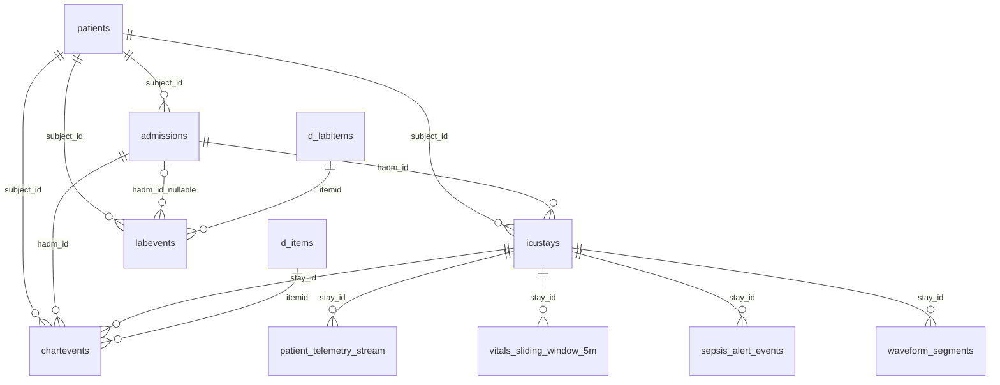

# Thiết kế TimescaleDB và hợp đồng Storage Writer

Database lưu lịch sử business event từ Kafka qua Storage Writer. Gateway
phục vụ live snapshot/WebSocket trực tiếp từ Kafka, không đọc DB. Tài liệu
này mô tả schema vật lý hiện tại: **11 bảng trong `public`, gồm 5 bảng tham
chiếu, 2 bảng nguồn PostgreSQL thường và 4 TimescaleDB Hypertable**.

Nguồn schema là [001_schema.sql](../docker/timescaledb/init/001_schema.sql),
[002_hypertables.sql](../docker/timescaledb/init/002_hypertables.sql) và
[003_indexes.sql](../docker/timescaledb/init/003_indexes.sql). JSON contract
nằm tại [KAFKA_MESSAGE_FORMATS.md](KAFKA_MESSAGE_FORMATS.md).

## Hạ tầng và quy ước thời gian

- Image `timescale/timescaledb:2.30.2-pg17`; container `icu-timescaledb`, cổng
  host `127.0.0.1:5432`, network `icu-streaming`.
- Volume `icu-timescale-data` gắn vào `/var/lib/postgresql/data`. `.env` cung
  cấp `POSTGRES_DB`, `POSTGRES_USER`, `POSTGRES_PASSWORD`; launcher tạo cấu
  hình từ `.env.example` nếu thiếu. User/password được khởi tạo trong volume
  lần đầu; sửa `.env` không tự đổi credential đã có.
- Healthcheck `pg_isready` thành công trước schema/seed và Writer.
- Timestamp nguồn MIMIC là `TIMESTAMP` không timezone; không tự gán UTC cho
  thời gian nguồn. Thời gian business là `TIMESTAMPTZ`, nhận timestamp UTC
  có timezone từ Kafka. Cách hiển thị SQL phụ thuộc timezone của session.
- TimescaleDB chia hypertable thành chunk theo thời gian; ứng dụng vẫn truy
  vấn bằng SQL bình thường. Chưa bật retention/compression policy hoặc
  benchmark chunk/index; không áp dụng các tùy chọn đó từ proposal cũ.

## Quan hệ giữa các bảng



Các FK là FK riêng lẻ như SQL, không phải composite FK kiểm tra toàn bộ bộ
định danh. Validation ở ứng dụng kiểm tra registry bốn patient.

## Năm bảng tham chiếu

PK là Primary Key, FK là Foreign Key. Ngoài PK, các cột được ghi rõ NOT NULL
bên dưới là bắt buộc; các cột còn lại nullable.

| Bảng | Các cột vật lý và kiểu | Khóa/ràng buộc |
|---|---|---|
| `patients` | `subject_id BIGINT`, `gender TEXT`, `anchor_age INTEGER`, `anchor_year INTEGER`, `anchor_year_group TEXT`, `dod DATE` | PK `subject_id`; không có cột `demo_id` |
| `admissions` | `hadm_id BIGINT`, `subject_id BIGINT NOT NULL`, `admittime TIMESTAMP`, `dischtime TIMESTAMP`, `admission_type TEXT`, `admission_location TEXT`, `discharge_location TEXT`; các cột bổ sung bên dưới | PK `hadm_id`; FK `subject_id → patients(subject_id)` |
| `icustays` | `stay_id BIGINT`, `subject_id BIGINT NOT NULL`, `hadm_id BIGINT NOT NULL`, `bed_id INTEGER NOT NULL`, `first_careunit TEXT`, `last_careunit TEXT`, `intime TIMESTAMP`, `outtime TIMESTAMP`, `los DOUBLE PRECISION` | PK `stay_id`; FK đến `patients`, `admissions`; UNIQUE `bed_id` |
| `d_items` | `itemid INTEGER`, `label TEXT`, `abbreviation TEXT`, `category TEXT`, `unitname TEXT`, `param_type TEXT`, `linksto TEXT`, `lownormalvalue DOUBLE PRECISION`, `highnormalvalue DOUBLE PRECISION` | PK `itemid` |
| `d_labitems` | `itemid INTEGER`, `label TEXT`, `fluid TEXT`, `category TEXT` | PK `itemid` |

`admissions` còn có các cột nullable: `deathtime TIMESTAMP`,
`admit_provider_id TEXT`, `insurance TEXT`, `language TEXT`,
`marital_status TEXT`, `race TEXT`, `edregtime TIMESTAMP`, `edouttime TIMESTAMP`,
`hospital_expire_flag SMALLINT CHECK (hospital_expire_flag IN (0,1))`.
Các cột bổ sung có trong schema nhưng seed hiện không tự tạo giá trị còn thiếu.

`demo_id` P01–P04 chỉ là mã ứng dụng trong
[demo_patients.yaml](../config/demo_patients.yaml), không được lưu vào `patients`
hoặc chuyển sang một bảng DB khác. Registry ánh xạ demo_id → subject_id →
hadm_id → stay_id → bed_id. Giường là **INTEGER** cố định: P01=1, P02=2, P03=3,
P04=4; đây là ánh xạ mô phỏng, không phải trường nguồn MIMIC. API vẫn tra cứu
bằng P01–P04 nhưng trả `bed_id` dạng số. Seed không chứa `patients.demo_id`.

[Seed JSON](../config/db_reference_seed.json) nạp **4 patients / 4 admissions /
4 icustays / 6 d_items / 1 d_labitems**. Startup upsert reference theo PK;
không tải CSV MIMIC khi demo. [Công cụ đối chiếu seed](../scripts/reference/build_db_seed.py)
dành cho việc kiểm tra lại nguồn, không thuộc đường chạy thông thường.

| Item | Signal / đơn vị |
|---|---|
| `220045` | HR / bpm |
| `220052` | MAP / mmHg |
| `220050` | SBP / mmHg |
| `220051` | DBP / mmHg |
| `220277` | SpO2 / % |
| `220210` | RR / insp/min |
| `50813` trong `d_labitems` | Lactate / mmol/L |

## Hai bảng nguồn để trống

`chartevents` và `labevents` giữ cấu trúc nguồn, **không phải streaming sink**,
không phải hypertable. Runtime đúng thiết kế có **0 hàng ở cả hai bảng trước
và sau demo**; launcher kiểm tra và báo lỗi nếu chúng có dữ liệu.

| Bảng | Cột NOT NULL và FK | Cột nullable |
|---|---|---|
| `chartevents` | `subject_id BIGINT → patients`, `hadm_id BIGINT → admissions`, `stay_id BIGINT → icustays`, `charttime TIMESTAMP`, `itemid INTEGER → d_items` | `value TEXT`, `valuenum DOUBLE PRECISION`, `valueuom TEXT` |
| `labevents` | `subject_id BIGINT → patients`, `charttime TIMESTAMP`, `itemid INTEGER → d_labitems` | `hadm_id BIGINT → admissions`, `value TEXT`, `valuenum DOUBLE PRECISION`, `valueuom TEXT`, `flags TEXT` |

Không có PK hay index bổ sung cho hai placeholder này. `labevents` không có
`stay_id`/`mapped_stay_id` vật lý. `mapped_stay_id` chỉ là field RAW lab của
dự án. Lab hợp lệ hiện được Flink log sau validation/dedup/Event Time, chưa
ghi DB hoặc chiếu ra UI. BR-6 correlation chưa được triển khai.

## Bốn business hypertable

DDL sau phản ánh các bảng thực sự được tạo. Chỉ ba bảng đầu có streaming
writes; metadata Kafka không được lưu thành cột DB.

### `patient_telemetry_stream`

Một hàng wide cho một `stay_id + sample_time`; field thiếu được lưu NULL.
DBP/RR vẫn ở RAW, không nằm trong bảng này.

```sql
CREATE TABLE IF NOT EXISTS patient_telemetry_stream (
    sample_time TIMESTAMPTZ NOT NULL,
    stay_id BIGINT NOT NULL REFERENCES icustays(stay_id),
    heart_rate DOUBLE PRECISION CHECK (heart_rate IS NULL OR heart_rate BETWEEN 0 AND 350),
    map DOUBLE PRECISION CHECK (map IS NULL OR map BETWEEN 0 AND 300),
    sbp DOUBLE PRECISION CHECK (sbp IS NULL OR sbp BETWEEN 0 AND 350),
    spo2 DOUBLE PRECISION CHECK (spo2 IS NULL OR spo2 BETWEEN 0 AND 100),
    PRIMARY KEY (sample_time, stay_id)
);
```

### `vitals_sliding_window_5m`

Một hàng cho mỗi stay/cửa sổ đã đóng: Flink tính mean của từng field khác null
trên `[window_end − 5 phút, window_end)`, slide 1 phút. Writer không tính lại.
DB không có CHECK range cho `avg_*`; consumer validation kiểm tra range.
Flink tính thêm population variance bằng Welford, đếm độc lập từng tín hiệu:
`N=0` mean/variance NULL; `N=1` variance NULL; `N>=2` dùng `M2/N`, tín hiệu
hằng có variance 0. `var_*` phải hữu hạn và không âm theo consumer validation.

```sql
CREATE TABLE IF NOT EXISTS vitals_sliding_window_5m (
    window_end TIMESTAMPTZ NOT NULL,
    stay_id BIGINT NOT NULL REFERENCES icustays(stay_id),
    avg_heart_rate DOUBLE PRECISION, avg_map DOUBLE PRECISION,
    avg_sbp DOUBLE PRECISION, avg_spo2 DOUBLE PRECISION,
    var_heart_rate DOUBLE PRECISION, var_map DOUBLE PRECISION,
    var_sbp DOUBLE PRECISION, var_spo2 DOUBLE PRECISION,
    PRIMARY KEY (window_end, stay_id)
);
```

Bốn cột nullable được tạo trong `V3__create_hypertables.sql` bằng `ADD COLUMN
IF NOT EXISTS`, không có V6 riêng. Với DB đã áp dụng V3 cũ: sao lưu, áp dụng
phần thêm cột rồi Flyway repair/validate checksum trước khi khởi động server mới.
Hàng cũ giữ nguyên, variance ban đầu là NULL; message cũ thiếu `var_*` cũng lưu
NULL. Giữ PK, hypertable, indexes và `ON CONFLICT DO NOTHING`; không backfill.

### `sepsis_alert_events`

Một hàng alert cùng status hiện tại. `alert_time` là Event Time của bucket
low xác nhận đủ evidence, không phải thời gian insert DB. `alert_id` là UUIDv5
ổn định theo episode. `trigger_value` là median MAP của bucket kích hoạt.

```sql
CREATE TABLE IF NOT EXISTS sepsis_alert_events (
    alert_time TIMESTAMPTZ NOT NULL,
    alert_id UUID NOT NULL,
    stay_id BIGINT NOT NULL REFERENCES icustays(stay_id),
    alert_type TEXT NOT NULL CHECK (alert_type IN ('HYPOTENSION_SUSTAINED','QSOFA_HIGH_RISK','SENSOR_DISCONNECTED')),
    severity TEXT NOT NULL CHECK (severity IN ('WARNING','CRITICAL')),
    trigger_value DOUBLE PRECISION, trigger_message TEXT NOT NULL,
    status TEXT NOT NULL DEFAULT 'ACTIVE' CHECK (status IN ('ACTIVE','ACKNOWLEDGED','FALSE_ALARM')),
    PRIMARY KEY (alert_time, alert_id)
);
```

Runtime chỉ tính `HYPOTENSION_SUSTAINED`, phát `CRITICAL/ACTIVE`. Hai loại còn
lại mới là enum được chấp nhận, chưa có rule phát. Recovery kết thúc processing
episode, không xóa alert hoặc tự đổi status. `ACKNOWLEDGED`/`FALSE_ALARM` được
cập nhật qua status event; chưa có REST endpoint thao tác status cho người dùng.
Bảng lưu lịch sử alert với **status mới nhất**, không lưu từng lần đổi status.

### `waveform_segments`

Placeholder chỉ có ba cột metadata; chưa có waveform topic/producer/Writer.
Không có các cột đường dẫn file, sampling rate hay waveform array.

```sql
CREATE TABLE IF NOT EXISTS waveform_segments (
    segment_start TIMESTAMPTZ NOT NULL,
    segment_id UUID NOT NULL,
    stay_id BIGINT NOT NULL REFERENCES icustays(stay_id),
    PRIMARY KEY (segment_start, segment_id)
);
```

| Hypertable | Time partition column | Chunk interval | Kafka source / streaming writes |
|---|---|---|---|
| `patient_telemetry_stream` | `sample_time` | 1 hour | `icu.telemetry` / có |
| `vitals_sliding_window_5m` | `window_end` | 1 day | `icu.vitals.5m` / có |
| `sepsis_alert_events` | `alert_time` | 1 day | `icu.alerts` / có |
| `waveform_segments` | `segment_start` | 1 day | Không / không, 0 hàng |

Cả bốn dùng `create_default_indexes => FALSE`; PK vẫn tạo unique index chứa
cột partition thời gian. Không có FK nào khác ngoài `stay_id → icustays` ở
mỗi hypertable. Chunk interval là cấu hình hiện tại, chưa phải kết quả tuning.

## Index bổ sung

Ngoài PK và UNIQUE của reference, SQL khai báo đúng các index sau:

| Tên | Bảng / cột | Điều kiện |
|---|---|---|
| `idx_admissions_subject` | `admissions(subject_id)` | — |
| `idx_icustays_subject` | `icustays(subject_id)` | — |
| `idx_icustays_hadm` | `icustays(hadm_id)` | — |
| `idx_icustays_bed` | `icustays(bed_id)` | — |
| `idx_patient_telemetry_stay_time` | `patient_telemetry_stream(stay_id, sample_time DESC)` | — |
| `idx_vitals_window_stay_time` | `vitals_sliding_window_5m(stay_id, window_end DESC)` | — |
| `idx_sepsis_alert_stay_time` | `sepsis_alert_events(stay_id, alert_time DESC)` | — |
| `idx_sepsis_alert_type_time` | `sepsis_alert_events(alert_type, alert_time DESC)` | — |
| `idx_sepsis_alert_active_time` | `sepsis_alert_events(alert_time DESC)` | `WHERE status = 'ACTIVE'` |
| `idx_sepsis_alert_active_severity` | `sepsis_alert_events(severity, alert_time DESC)` | `WHERE status = 'ACTIVE'` |

`waveform_segments` chỉ có index PK, không có index bổ sung.

## Ghi dữ liệu, Idempotency và lỗi

Writer group `icu-timescale-writer-v2` subscribe đúng `icu.telemetry`,
`icu.vitals.5m`, `icu.alerts`. Nó không đọc RAW/DLQ; Gateway dùng group riêng.

Với create/telemetry/window: Kafka poll → validate body/key/headers và registry
→ DB transaction → `INSERT ... ON CONFLICT DO NOTHING` → **DB commit → Kafka
offset commit đồng bộ**. Replay cùng khóa tự nhiên không thêm hàng. Message
khác nội dung nhưng trùng khóa DB cũng bị `DO NOTHING`; Writer không có phép
so toàn payload để phát hiện mọi Idempotency conflict.

Status event dùng `UPDATE ... WHERE alert_time = ... AND alert_id = ... AND
stay_id = ...`, chỉ đổi `status`. Không tìm thấy thì `ALERT_NOT_FOUND` → DLQ,
không insert. Lặp cùng status trên cùng alert không thêm hàng. Chưa có version/
compare-and-set cho status: một status khác đến sau có thể ghi đè status trước.

Nếu crash sau DB commit nhưng trước offset commit, message đọc lại được PK
chặn trùng: ngữ nghĩa **AT_LEAST_ONCE**. Lỗi DB tạm thời thử tối đa 8 lần,
backoff từ 0,25 giây và giới hạn 5 giây/lần chờ. Hết lượt → DLQ
`DB_WRITE_ERROR`, `retryable=true`, `attempt=8`. Sai contract/reference/constraint
được chuyển DLQ theo mã lỗi. Offset chỉ tiến sau DB thành công hoặc DLQ đã
được Kafka xác nhận; DLQ delivery thất bại thì không commit offset gốc.
Không có auto replay DLQ, nên DB có thể thiếu message đã chuyển DLQ cho đến
khi có xử lý/replay riêng. Không hứa DB tự bắt kịp mọi lỗi chỉ bằng restart.

## Khởi tạo, migration và reset

Launcher đợi DB healthy, áp dụng schema và upsert seed. Với schema nguồn cũ,
nó dừng consumer dự án, tạo full `pg_dump` archive và kiểm tra archive bằng
`pg_restore --list` trước migration. Việc kiểm tra danh sách archive không
thay cho một lần thử restore hoàn chỉnh. Schema/drop nguồn cũ/seed/reset nằm
trong transaction. Các bảng output cũ chỉ được retire sau FastVerify thành
công; nếu nâng cấp máy còn schema cũ mà chưa verify, có thể còn bảng legacy.

Nếu DB còn `patients.demo_id` hoặc `icustays.bed_id` kiểu TEXT, launcher cũng
backup trước migration reference. Migration kiểm tra identity và mapping
legacy `BED-01`→1, `BED-02`→2, `BED-03`→3, `BED-04`→4 trước khi đổi kiểu;
giá trị/mapping lạ làm dừng rõ lỗi, không đoán hoặc cast tùy ý. Chuyển kiểu
và bỏ `patients.demo_id` cùng UNIQUE/index của cột đó nằm trong transaction,
không dùng CASCADE. Chạy lại trên schema integer hợp lệ không thay đổi dữ
liệu. Migration giữ reference, business rows, FK/PK và volume; không reset
dữ liệu chỉ để đổi hai field này. Reset demo bên dưới là bước riêng của launcher.

Sau khi migration/retirement hoàn tất, target là 11 bảng/4 hypertable ở trên.
Demo mặc định chỉ reset dữ liệu của `patient_telemetry_stream`,
`vitals_sliding_window_5m`, `sepsis_alert_events`, `waveform_segments`; giữ
references và volume. `-KeepDatabaseData` bỏ reset bốn bảng này và chọn clock
sau `max(sample_time)` đã lưu; Kafka/Gateway vẫn reset. FastVerify luôn dùng
trạng thái sạch, còn kiểm tra duplicate insert và status update.

## SQL kiểm tra thực tế

Mở terminal theo [README](../README.md), rồi vào `psql`:

```powershell
docker exec -it icu-timescaledb psql -U icu_app -d icu
```

Nếu thay `.env`, dùng đúng user/database tương ứng. Các truy vấn dưới đây
chỉ đọc dữ liệu; `SET TIME ZONE` chỉ thay cách hiển thị trong session.

```sql
SET TIME ZONE 'UTC';

-- Reference identity: integer; truy vấn demo_id phải trả 0 hàng
SELECT column_name, data_type FROM information_schema.columns
WHERE table_schema = 'public' AND table_name = 'icustays' AND column_name = 'bed_id';
SELECT column_name FROM information_schema.columns
WHERE table_schema = 'public' AND table_name = 'patients' AND column_name = 'demo_id';
SELECT stay_id, subject_id, hadm_id, bed_id FROM icustays ORDER BY bed_id;
SELECT count(*) AS total, count(DISTINCT bed_id) AS distinct_beds FROM icustays;

-- 1. Reference counts: 4 / 4 / 4 / 6 / 1
SELECT 'patients' AS table_name, count(*) FROM patients
UNION ALL SELECT 'admissions', count(*) FROM admissions
UNION ALL SELECT 'icustays', count(*) FROM icustays
UNION ALL SELECT 'd_items', count(*) FROM d_items
UNION ALL SELECT 'd_labitems', count(*) FROM d_labitems;

-- 2. Hai source placeholder phải đều 0
SELECT 'chartevents' AS table_name, count(*) FROM chartevents
UNION ALL SELECT 'labevents', count(*) FROM labevents;

-- 3. Số hàng business
SELECT 'patient_telemetry_stream' AS table_name, count(*) FROM patient_telemetry_stream
UNION ALL SELECT 'vitals_sliding_window_5m', count(*) FROM vitals_sliding_window_5m
UNION ALL SELECT 'sepsis_alert_events', count(*) FROM sepsis_alert_events;

-- 4. Telemetry mới nhất; giường lấy từ reference
SELECT t.sample_time, t.stay_id, i.bed_id, t.heart_rate, t.map, t.sbp, t.spo2
FROM patient_telemetry_stream t JOIN icustays i USING (stay_id)
ORDER BY t.sample_time DESC, t.stay_id LIMIT 20;

-- 5. Trung bình cửa sổ đã đóng
SELECT window_end - INTERVAL '5 minutes' AS window_start, window_end,
       stay_id, avg_heart_rate, avg_map, avg_sbp, avg_spo2
FROM vitals_sliding_window_5m ORDER BY window_end DESC, stay_id LIMIT 20;

-- 6. Lịch sử cảnh báo
SELECT alert_time, alert_id, stay_id, alert_type, severity,
       trigger_value, trigger_message, status
FROM sepsis_alert_events ORDER BY alert_time DESC LIMIT 20;

-- 7. Active và acknowledged
SELECT alert_time, alert_id, stay_id, severity, status
FROM sepsis_alert_events WHERE status IN ('ACTIVE', 'ACKNOWLEDGED')
ORDER BY alert_time DESC;

-- 8. Extension, danh sách bảng và đúng 4 hypertable
SELECT extversion FROM pg_extension WHERE extname = 'timescaledb';
SELECT table_name FROM information_schema.tables
WHERE table_schema = 'public' AND table_type = 'BASE TABLE' ORDER BY table_name;
SELECT hypertable_name FROM timescaledb_information.hypertables
WHERE hypertable_schema = 'public' ORDER BY hypertable_name;

-- 9. Waveform placeholder phải 0
SELECT count(*) FROM waveform_segments;
```

Rule MAP/recovery và giới hạn lâm sàng nằm tại
[ALERT_RULES_AND_FALSE_ALARM_MANAGEMENT.md](ALERT_RULES_AND_FALSE_ALARM_MANAGEMENT.md);
luồng Kafka/consumer tại [KAFKA_FLINK_FLOW.md](../KAFKA_FLINK_FLOW.md).
